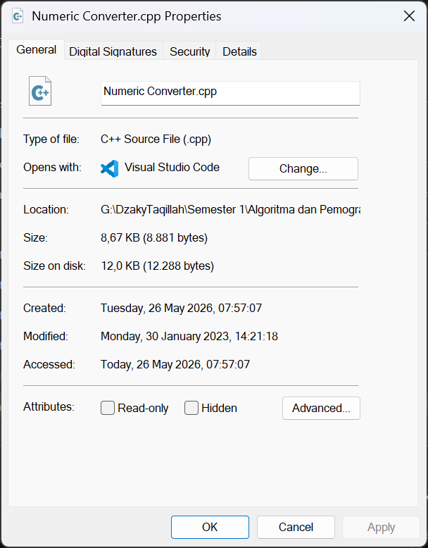
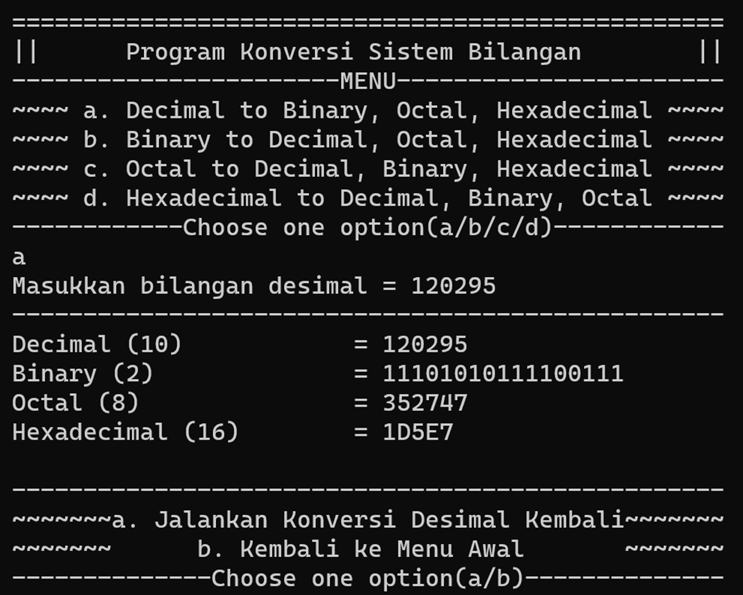

# Numeric Converter – My First Functional Code

Ini adalah kode fungsional pertama yang pernah saya buat menggunakan bahasa pemrograman **C++** untuk melakukan konversi sistem bilangan dua arah antara **Desimal (Basis 10)**, **Biner (Basis 2)**, **Oktal (Basis 8)**, dan **Heksadesimal (Basis 16)**. 

Program berbasis antarmuka baris perintah (*Command-Line Interface* / CLI) ini awalnya dikembangkan untuk memenuhi tugas akhir mata kuliah **Algoritma dan Pemrograman** pada Semester 1 (Oktober 2022 – Januari 2023).



---

## Latar Belakang & Pengembangan Ulang (Refactoring ke OOP)

Pada saat pertama kali membuat program ini di semester 1, saya belum mempelajari konsep **Pemrograman Berorientasi Objek (*Object-Oriented Programming* / OOP)**, sehingga logika konversi dituliskan secara prosedural dan berulang-ulang di setiap menu. 

Beberapa bulan setelahnya (Agustus 2023), saya berinisiatif melakukan *refactoring* dan menulis ulang (*rewrite*) program ini dengan menerapkan konsep **OOP** agar struktur kode jauh lebih modular, ringkas, dan mudah dipelihara (*reusable*).


---

## Fitur Utama & Logika Teknis

1. **Konversi Multi-Basis Sekaligus:**
   Setiap kali pengguna memasukkan satu jenis bilangan pada menu (Desimal, Biner, Oktal, atau Heksadesimal), program otomatis menampilkan hasil konversinya ke **ketiga sistem bilangan lainnya** secara serentak:
   * **Menu A:** Desimal $\rightarrow$ Biner, Oktal, Heksadesimal
   * **Menu B:** Biner $\rightarrow$ Desimal, Oktal, Heksadesimal
   * **Menu C:** Oktal $\rightarrow$ Desimal, Biner, Heksadesimal
   * **Menu D:** Heksadesimal $\rightarrow$ Desimal, Biner, Oktal
2. **Desain Kelas Modular & *Code Reusability*:**
   * **`class Dec`:** Mengenkapsulasi algoritma pembagian berulang dan operasi modulo (`% 2`, `% 8`, `% 16`), pemetaan nilai `10–15` menjadi huruf `A–F` untuk heksadesimal, konversi tipe data menggunakan `std::stringstream`, serta pencetakan string terbalik (*reverse iteration*).
   * **`class Bin` & `class Oct`:** Mengonversi input biner dan oktal menjadi nilai integer desimal terlebih dahulu melalui perkalian bobot posisi ($2^n$ dan $8^n$), kemudian memanfaatkan kembali metode pada `class Dec` untuk menghasilkan output oktal, biner, dan heksadesimal tanpa duplikasi kode.
   * **Pemanfaatan *Stream Manipulator* (`std::hex`):** Menggunakan `cin >> hex >> decimal` untuk memproses input karakter heksadesimal secara efisien sebelum didistribusikan ke metode konversi `class Dec`.
3. **Navigasi Menu Interaktif:** Dilengkapi fitur pengulangan konversi pada basis bilangan yang sama atau kembali ke menu utama secara langsung tanpa perlu menjalankan ulang program.

---

## Tech Stack

* **Bahasa Pemrograman:** C++
* **Paradigma Pemrograman:** Object-Oriented Programming (OOP)
* **Pustaka Standar (Standard Library):** `<iostream>`, `<sstream>` (`stringstream`), `<string>`

---

## Cara Menjalankan Program

Pastikan perangkat Anda telah terinstal kompiler C++ (seperti **GCC / g++** melalui MinGW pada Windows atau terminal Linux/macOS).

1. Kloning repositori ini:
   ```bash
   git clone [https://github.com/mdzakytaqillah/NumericConverter-.-My-First-Functional-Code.git](https://github.com/mdzakytaqillah/NumericConverter-.-My-First-Functional-Code.git)
   cd NumericConverter-.-My-First-Functional-Code
   ```
2. Kompilasi file kode sumber C++:
   ```bash
   g++ "Numeric Converter.cpp" -o numeric_converter
   ```
3. Jalankan program:
   ```bash
   ./numeric_converter
   ```

---

## Hasil Tampilan Program

